# HireVision AI 🚀

[](https://github.com/safa-hmd/HireVision-ai/actions/workflows/ci.yml)
[](https://github.com/safa-hmd/HireVision-ai/actions/workflows/cd.yml)


## 📌 Description

**HireVision AI** is an intelligent recruitment and interview preparation platform that uses AI to analyze resumes, match candidates with job offers, generate personalized interview questions, and provide detailed feedback based on technical, vocal, and behavioral performance.

It provides:

- intelligent resume (CV) analysis;
- candidate–job offer matching;
- technical interview simulation;
- a **Developer Readiness Score**;
- a personalized learning roadmap;
- voice and behavioral analysis of interview answers.

🔗 **Live demo**: [hirevision-frontend.gentlebay-58ff12f9.swedencentral.azurecontainerapps.io](https://hirevision-frontend.gentlebay-58ff12f9.swedencentral.azurecontainerapps.io/frontoffice/home)

---

## 🏗️ Architecture

HireVision AI is built on a multi-layer architecture: an Angular frontend, a Spring Boot backend, a MySQL database, and a FastAPI-based AI microservice.

### Logical architecture

<p align="center">
  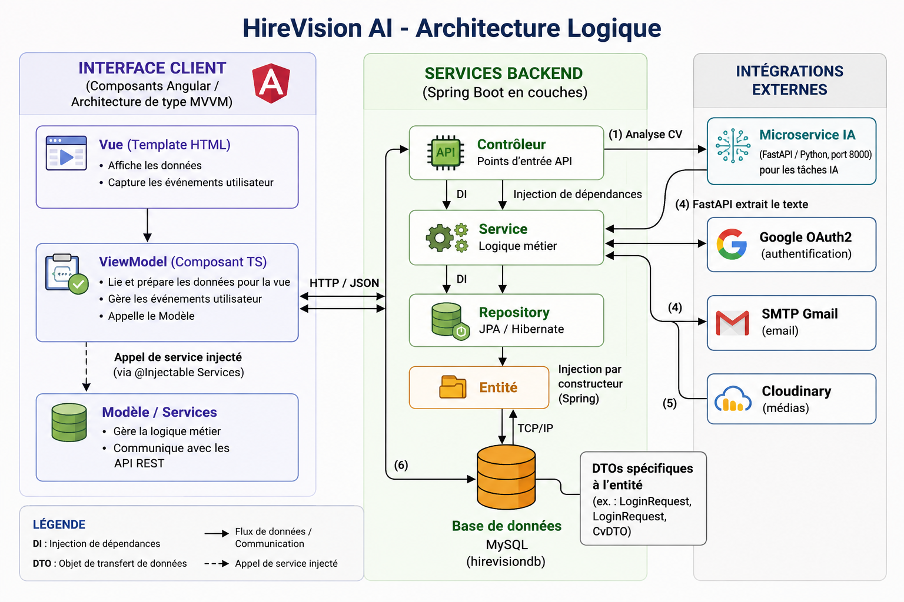
</p>

### Physical architecture

<p align="center">
  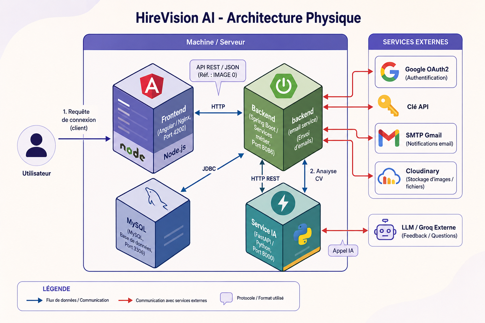
</p>

> **⚠️ Important:** these two diagrams are the source of truth for how the three services (Angular, Spring Boot, FastAPI) and the database talk to each other — check them first before changing any service URL, port, or network config.

---

## 📁 Project structure

```
HireVision-ai/
│
├── HireVision-ai/                  # Spring Boot backend
│   ├── src/
│   │   ├── main/
│   │   │   ├── java/com/projet/hirevisionai/
│   │   │   │   ├── Config/
│   │   │   │   ├── Controller/
│   │   │   │   ├── Dto/
│   │   │   │   ├── Entity/
│   │   │   │   ├── Repository/
│   │   │   │   ├── Security/
│   │   │   │   ├── ServiceImpl/
│   │   │   │   ├── ServiceInterface/
│   │   │   │   └── HirevisionAiApplication.java
│   │   │   │
│   │   │   └── resources/
│   │   │       ├── application.properties.example
│   │   │       └── application.properties
│   │   │
│   │   └── test/                   # Unit + integration tests (JUnit5, Mockito, H2)
│   │
│   ├── pom.xml
│   └── Dockerfile
│
├── HireVision-ai_FrontEnd/          # Angular frontend
│   ├── src/
│   │   ├── app/
│   │   │   ├── auth/
│   │   │   ├── frontoffice/
│   │   │   ├── backoffice/
│   │   │   ├── guards/
│   │   │   ├── interceptors/
│   │   │   └── services/
│   │   ├── environments/            # environment.ts / environment.prod.ts
│   │   ├── assets/
│   │   ├── main.ts
│   │   └── styles.css
│   │
│   ├── angular.json
│   ├── package.json
│   ├── tsconfig.json
│   └── Dockerfile
│
├── ai-service/                      # FastAPI AI microservice
│   ├── main.py
│   ├── extractor.py
│   ├── ml_model.py
│   ├── job_matcher.py
│   ├── interview_analyzer.py
│   ├── question_generator.py
│   ├── llm_client.py
│   ├── embeddings.py
│   ├── train_model.py
│   ├── clean_dataset.py
│   ├── dataset.csv
│   ├── dataset_clean.csv
│   ├── model.joblib
│   ├── tests/                       # pytest suite
│   ├── requirements.txt
│   └── Dockerfile
│
├── docs/
│   └── images/
│       ├── architecture-logique.png
│       └── architecture-physique.png
│
├── docker-compose.yml
├── .env.example
└── README.md
```

### Main folders

- `HireVision-ai/`: Spring Boot REST API — controllers, services, repositories, entities, DTOs, and security configuration.
- `HireVision-ai_FrontEnd/`: Angular app with auth, frontoffice, backoffice, guards, and services modules.
- `ai-service/`: FastAPI AI microservice responsible for resume analysis, job matching, interview questions, and feedback.
- `docs/images/`: architecture diagrams and screenshots used in this README.

---

## ✨ Features

### Candidate

- 📄 **AI resume analysis**: skill extraction, profile detection, overall score, and optimization recommendations.
- 🎯 **Job matching**: compatibility score between a candidate's resume and job offers.
- 🎤 **Interview simulation**: adaptive questions by specialty with answer analysis.
- 📊 **Developer Readiness Score**: a multi-axis score covering Backend, Frontend, Database, DevOps, Soft Skills, and Interview.
- 🗺️ **Personalized roadmap**: a weekly career plan based on detected gaps.
- 🏅 **Gamification**: badges, progress tracking, and performance history.
- 🌙 **Dark mode**: remembered across sessions.
- 🌐 **Multilingual**: French, English, and Arabic (RTL).

### Administrator

- Analytics dashboard.
- User management.
- Job offer management.
- Interview question management.
- Subscription management.
- Platform settings management.

---

## 🛠️ Tech stack

### Frontend

- Angular 17
- TypeScript
- HTML5 / CSS3
- RxJS
- Chart.js
- CoreUI
- ngx-translate

### Backend

- Java 17
- Spring Boot
- Spring Security
- JWT
- Spring Data JPA
- Hibernate
- Maven
- Swagger / SpringDoc OpenAPI

### AI / Machine Learning

- Python
- FastAPI
- sentence-transformers (`paraphrase-multilingual-MiniLM-L12-v2`)
- pdfplumber
- OpenCV
- NumPy
- Joblib
- Groq / LLM API

### Database & external services

- MySQL
- Google OAuth2
- SMTP Gmail
- Cloudinary

### DevOps

- Docker / Docker Compose
- Nginx
- GitHub Actions (CI/CD)
- Docker Hub
- Azure Container Apps
- Azure Database for MySQL

---

## ✅ Tests

The project is covered by tests across all three layers:

| Layer | Tools | Coverage |
|---|---|---|
| Backend | JUnit5, Mockito, H2 (in-memory) | Service unit tests, integration tests (`AbstractIntegrationTest`), controller tests (auth, user, CV, job offers, security) |
| Frontend | Jasmine / Karma | 19 `spec.ts` files covering services, guards, interceptors, and pipes |
| AI service | pytest | Job matching, ML model, resume extraction, question generation, LLM client, GitHub analysis |

```bash
# Backend
cd HireVision-ai
./mvnw test

# Frontend
cd HireVision-ai_FrontEnd
npm test

# AI service
cd ai-service
pytest
```

---

## 🚀 Quick start with Docker

### 1. Clone the project
```bash
git clone https://github.com/safa-hmd/HireVision-ai.git
cd HireVision-ai
```

### 2. Configure environment variables
```bash
cp .env.example .env
```

Then fill in the required values in `.env`:

```
GROQ_API_KEY=your_groq_api_key
JWT_SECRET=your_jwt_secret
GOOGLE_CLIENT_ID=your_google_client_id
GOOGLE_CLIENT_SECRET=your_google_client_secret
MAIL_USERNAME=your_email
MAIL_PASSWORD=your_app_password
```

### 3. Start all services
```bash
docker compose up --build
```

### Available services

| Service | URL |
|---|---|
| Frontend | `http://localhost:4200` |
| Backend | `http://localhost:8086/HireVision` |
| Backend Swagger | `http://localhost:8086/HireVision/swagger-ui.html` |
| AI Service Docs | `http://localhost:8000/docs` |

---

## Prerequisites for local development

To run the project without Docker, you'll need:

- Java 17+
- Maven
- Node.js 18+
- npm
- Python 3.10+
- MySQL 8.0

---

## Local installation

### 1. Spring Boot backend

```bash
cd HireVision-ai
cp src/main/resources/application.properties.example src/main/resources/application.properties
```

Configure `src/main/resources/application.properties`, then start the backend:

```bash
./mvnw spring-boot:run
```

On Windows:
```powershell
mvnw.cmd spring-boot:run
```

The backend starts at: `http://localhost:8086/HireVision`
Swagger UI: `http://localhost:8086/HireVision/swagger-ui.html`

---

### 2. FastAPI AI service

```bash
cd ai-service
python -m venv venv
```

On Windows:
```powershell
venv\Scripts\activate
```

On Linux / macOS:
```bash
source venv/bin/activate
```

Install dependencies:
```bash
pip install -r requirements.txt
```

Create the `.env` file:
```bash
cp .env.example .env
```

Then set the key:
```
GROQ_API_KEY=your_groq_api_key
```

Start the AI service:
```bash
uvicorn main:app --host 0.0.0.0 --port 8000 --reload
```

The AI service starts at: `http://localhost:8000`
Interactive docs: `http://localhost:8000/docs`

---

### 3. Angular frontend

```bash
cd HireVision-ai_FrontEnd
npm install
npm start
```

The frontend starts at: `http://localhost:4200`

---

## 🔒 Security

- Sensitive secrets are externalized via environment variables.
- `.env` and `application.properties` files containing real values must never be committed.
- Sensitive files must be added to `.gitignore`.
- Protected endpoints require a valid JWT.
- CV- and matching-related endpoints verify resource ownership.
- The AI service enforces a restricted CORS configuration.

---

## 🐳 Docker

Each service has its own `Dockerfile`.

| File | Service |
|---|---|
| `HireVision-ai/Dockerfile` | Spring Boot backend |
| `HireVision-ai_FrontEnd/Dockerfile` | Angular frontend + Nginx |
| `ai-service/Dockerfile` | FastAPI AI service |
| `docker-compose.yml` | Full orchestration |

```bash
docker compose up --build    # First run
docker compose up -d         # Detached mode (background)
docker compose down          # Stop and remove containers
docker compose down -v       # + remove volumes (resets the DB)
```

---

## 🔄 CI/CD

The project uses **GitHub Actions** for continuous integration and delivery.

### CI pipeline

Triggered automatically on every `push` and `pull request`:

- Backend build with Maven
- Frontend build with npm and Angular CLI
- Docker image builds via Docker Compose

### CD pipeline

Triggered after the CI pipeline succeeds:

- Sign in to Docker Hub via GitHub secrets
- Build Docker images
- Push images to Docker Hub

### Required GitHub secrets

```
DOCKERHUB_USERNAME
DOCKERHUB_TOKEN
```

### Docker Hub images

```
hamdisafa/hirevision-backend:latest
hamdisafa/hirevision-frontend:latest
hamdisafa/hirevision-ai-service:latest
```

---

## ☁️ Azure deployment

The application is deployed to production on **Azure Container Apps**, backed by an **Azure Database for MySQL**.

### Azure resources

| Container App | Role | Region |
|---|---|---|
| `hirevision-frontend` | Angular + Nginx | Sweden Central |
| `hirevision-backend` | Spring Boot API | Sweden Central |
| `hirevision-ai-service` | FastAPI microservice | Sweden Central |
| `hirevision-mysql` | Database | Sweden Central |

- **Resource Group**: `hirevision-rg-swe`
- **Container Apps Environment**: `managedEnvironment-hirevision...`
- **Container registry**: Docker Hub

### Production URL

Frontend:
```
https://hirevision-frontend.gentlebay-58ff12f9.swedencentral.azurecontainerapps.io/frontoffice/home
```

### Deployment architecture

```
GitHub Repository
        │
        ▼
GitHub Actions CI/CD
        │
        ▼
    Docker Hub
        │
        ▼
Azure Container Apps
        │
        ├── Frontend Container
        ├── Backend Container
        └── AI Service Container
        │
        ▼
Azure Database for MySQL
```

> **⚠️ Important — points to watch during Azure deployment:**
> - Hardcoded `localhost` URLs in Angular services must be replaced with environment variables (`environment.ts` / `environment.prod.ts` + `fileReplacements` in `angular.json`).
> - The frontend `Dockerfile` must not reference a `proxy_pass` pointing at a Docker Compose hostname (invalid on Azure) — Nginx must call the backend's public URL directly.
> - `SPRING_DATASOURCE_URL`, `AI_SERVICE_URL`, and `FRONTEND_URL` must be set as environment variables on each Container App rather than hardcoded.

---

## 📚 API documentation

| URL | Description |
|---|---|
| `http://localhost:8086/HireVision/swagger-ui.html` | Backend Swagger UI |
| `http://localhost:8000/docs` | FastAPI Swagger UI |
| `http://localhost:8086/HireVision/actuator/health` | Backend health check |
| `http://localhost:8000/health` | AI service health check |

---

## 🖼️ Screenshots

### Login

<p align="center">
  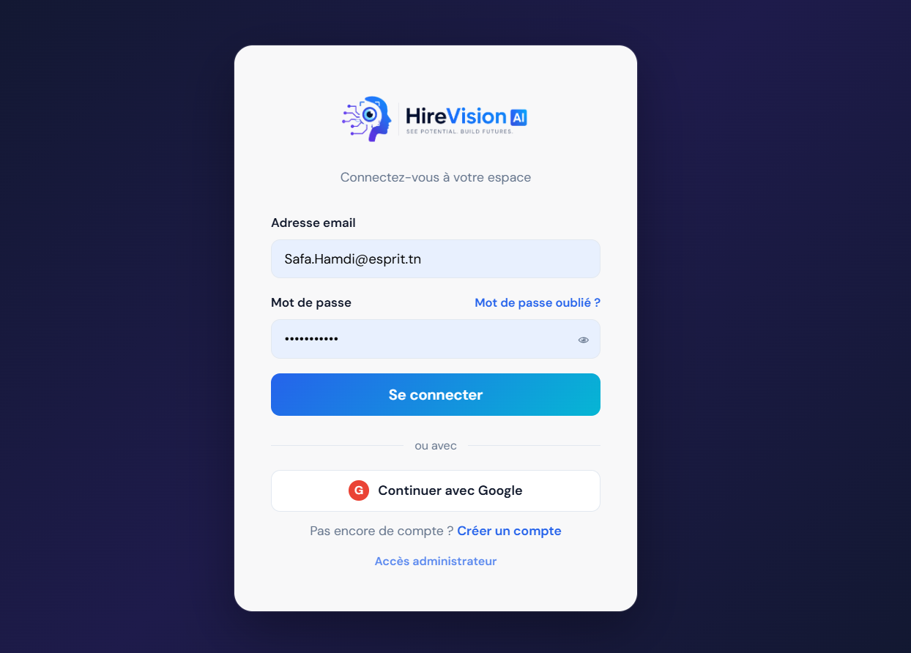
</p>

### Dashboard — Developer Readiness Score

<p align="center">
  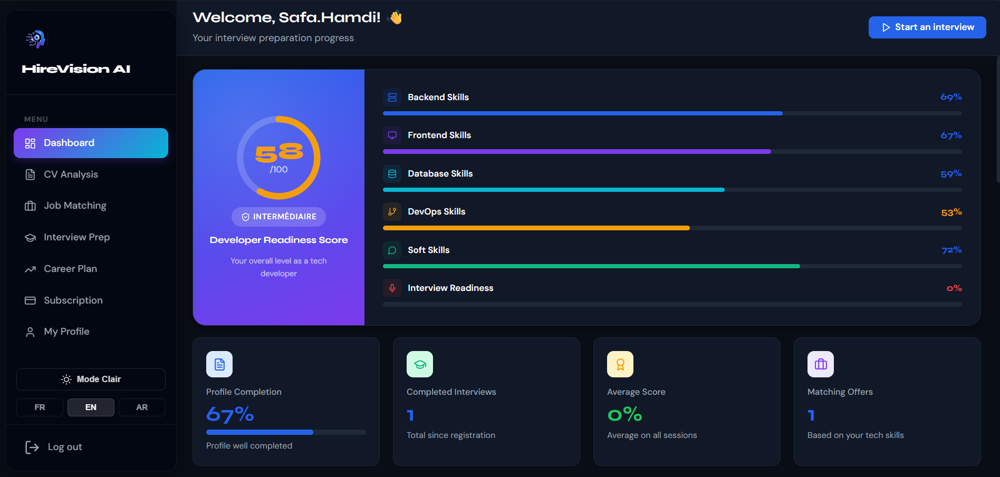
</p>

### AI resume analysis

<p align="center">
  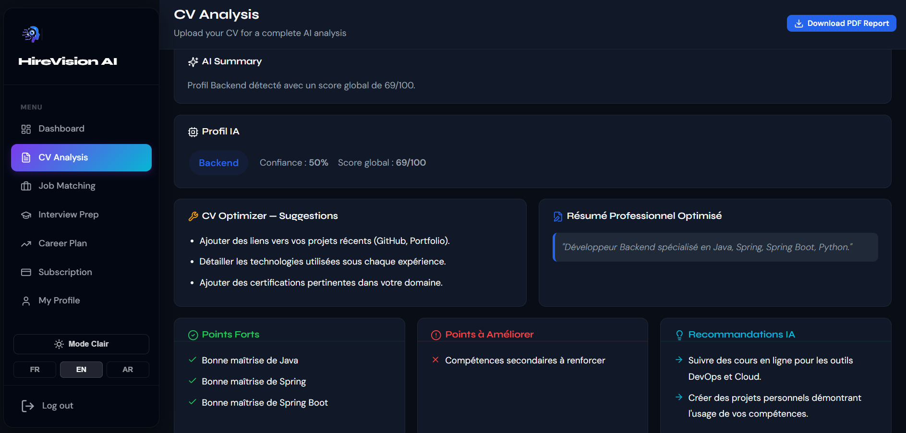
</p>

### Job matching

<p align="center">
  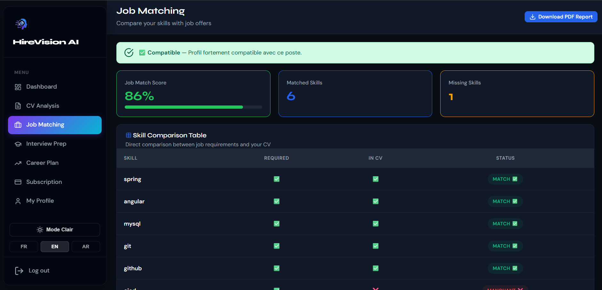
</p>

### Interview preparation

<p align="center">
  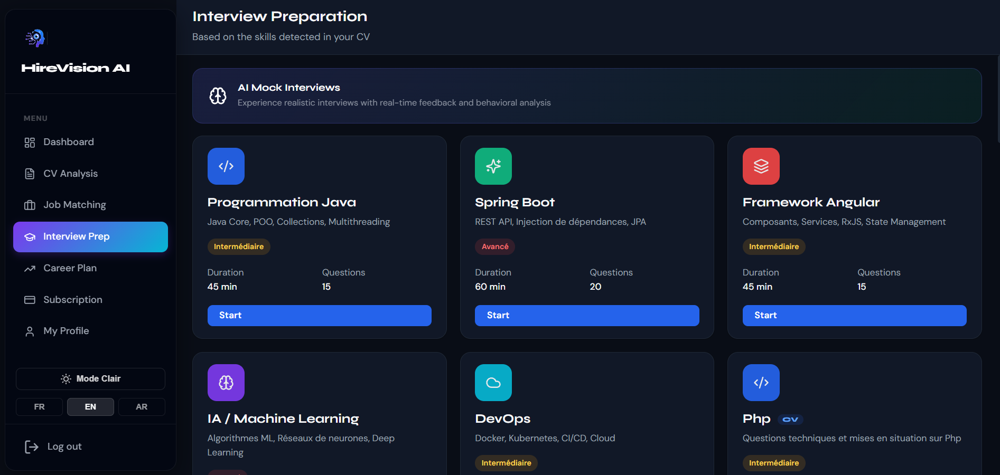
</p>

### AI interview session (real-time analysis)

<p align="center">
  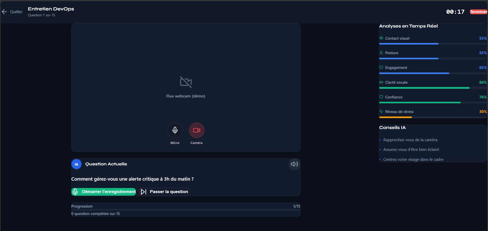
</p>

### Admin dashboard

<p align="center">
  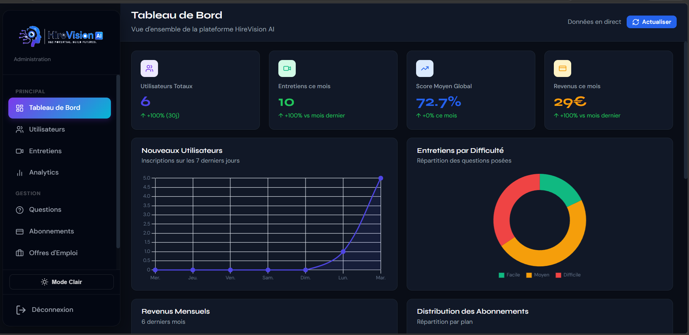
</p>

### CI/CD pipeline (GitHub Actions)

<p align="center">
  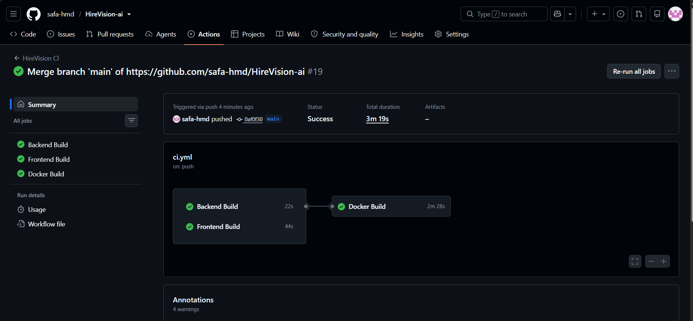
</p>

<p align="center">
  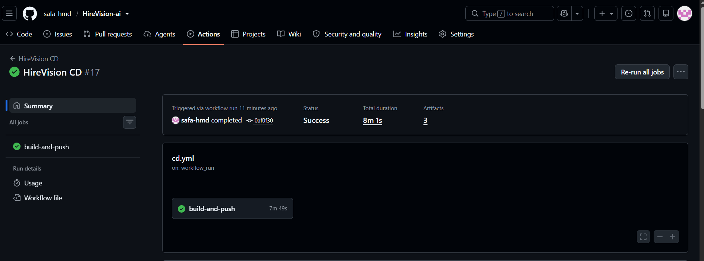
</p>

### Docker Hub images

<p align="center">
  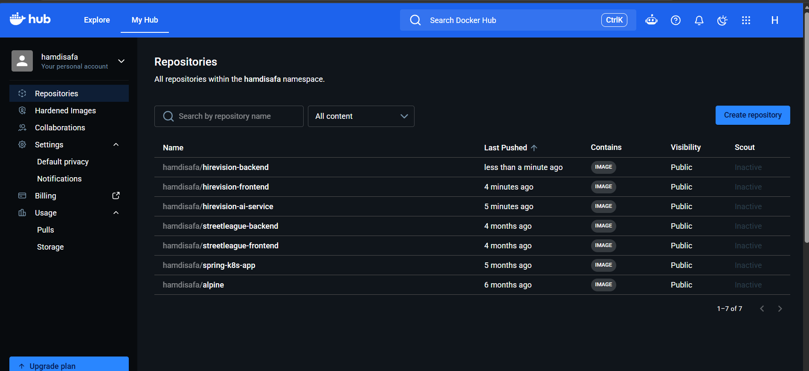
</p>

---

## ⚠️ Challenges faced

- Docker build timeouts when installing Python dependencies.
- Large image size for the AI service (ML dependencies).
- Handling hardcoded `localhost` URLs when moving to cloud deployment.
- Health check endpoints blocked by Spring Security.
- Infinite JSON recursion caused by bidirectional JPA relationships.
- Multi-service deployment on Azure Container Apps.

## 🔭 Possible future enhancements

The project is complete and deployed. Ideas that could extend it further:

- Optimize the AI service Docker image size.
- Add monitoring and logging on Azure.
- Automate Docker Hub → Azure deployment.
- Improve AI interview feedback.
- Harden production security configuration.

---

## 👤 Author

**Safa Hamdi**

Engineering student at ESPRIT.

GitHub: [safa-hmd](https://github.com/safa-hmd)

---

## 📄 License

© 2026 HireVision AI — All rights reserved.
